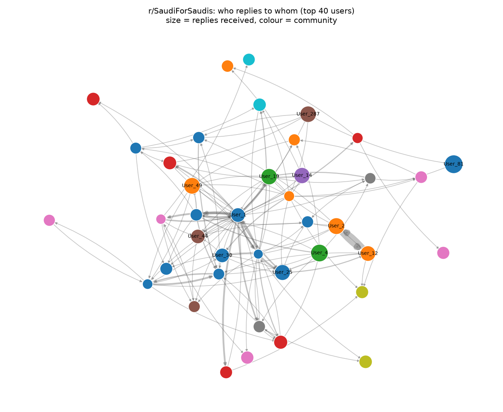
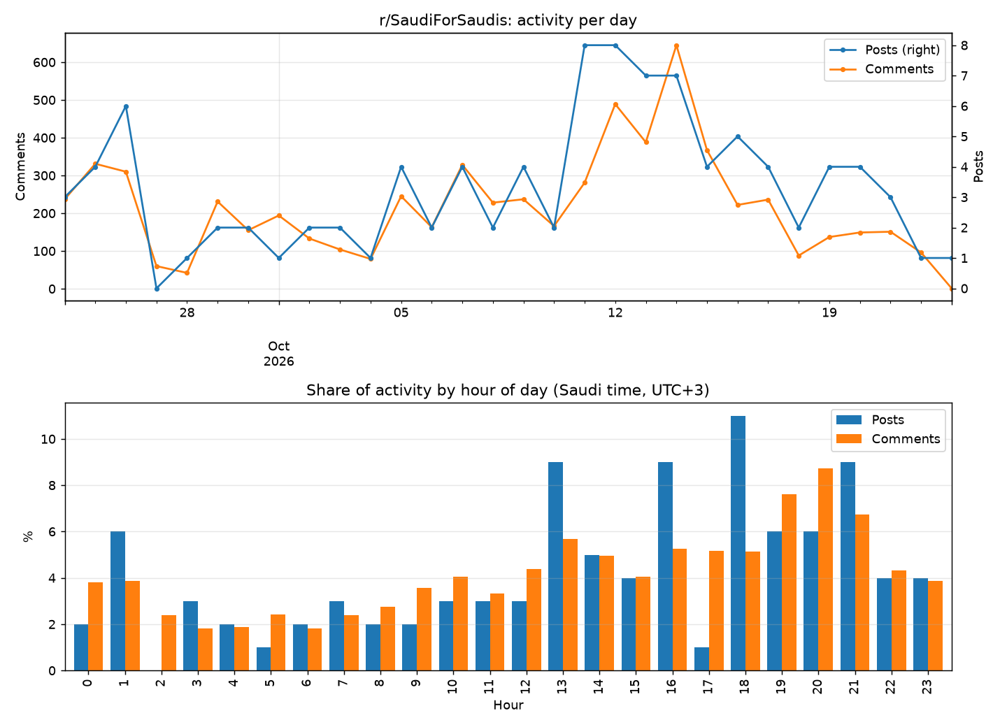

# sredit

A small script that downloads posts and comments from a subreddit, saves them as CSV files, and analyzes who replies to whom.



*Each dot is a user and each arrow a reply. Bigger dots received more replies; colours show groups of users who mostly reply to each other.*

It tries Reddit's own `.json` endpoints first. If Reddit blocks the request (HTTP 403), it falls back to the public [Arctic Shift](https://arctic-shift.photon-reddit.com) archive, using Reddit's RSS feeds to keep the hot / top / rising order.

## Requirements

- Python 3.9+
```
pip install -r requirements.txt
```

## Usage

### Interactive

```
python sredit.py
```

The script asks for:

| Question | Default | Options |
|---|---|---|
| Subreddit name | `SaudiForSaudis` | any subreddit (with or without `r/`) |
| How many posts | `100` | any number |
| Sort by | `new` | `new`, `hot`, `top`, `rising` |
| Top of (only for `top`) | `week` | `hour`, `day`, `week`, `month`, `year`, `all` |
| Posts | `visible` | `visible` (shown on the subreddit only), `all` (including removed/deleted) |

### Command line

```
python sredit.py <subreddit> <num_posts> <sort> [period] [--all]
```

Examples:

```
python sredit.py SaudiProfessionals 100 new
python sredit.py SaudiProfessionals 50 top month
python sredit.py SaudiProfessionals 100 new --all
```

Without `--all`, only visible posts are saved. `--all` also keeps posts that their authors deleted or that moderators removed; leave it off unless you need them for moderation research.

## Output

Each subreddit gets its own folder under `data/`:

```
data/<subreddit>/
├── posts.csv
├── comments.csv
└── users.csv
```

**posts.csv**: `post_title`, `post_author`, `post_text`, `date`, `score`, `num_comments`, `url`, `status`

- `status` is `visible`, `removed` (removed by moderators or Reddit's filters) or `deleted` (deleted by the author).
- `score` is empty for posts under about 36 hours old when the data comes from the archive (see Notes).

**comments.csv**: `post_title`, `username`, `is_post_author`, `reply_to`, `comment`, `date`, `post_url`

**users.csv**: `username`, `posts`, `comments`, `total`, which counts each user's posts and comments across all saved data, sorted by total.

Dates are in Saudi time (UTC+3). Files are written as UTF-8 with BOM, so Arabic text opens correctly in Excel.

## Analysis

```
python analyze.py <subreddit> [output_folder]
```

Reads the saved CSVs (visible posts only) and writes to `data/<subreddit>/analysis/`:

- **reply_network.png**: who replies to whom. Each user is a node; an arrow from A to B means A replied to B (a top-level comment counts as a reply to the post's author). Node size is replies received, colour is the community found by modularity clustering.
- **activity.png**: posts and comments per day, and the share of each by hour of day.
- **network_users.csv**: per user: `replies_received`, `replies_sent`, `people_talked_to`, `betweenness`, `community`.

Usernames are replaced with `User_1`, `User_2`, ... ranked by activity, so the output can be shared. `[deleted]` accounts, AutoModerator and replies to yourself are left out.

The images above and below come from the top 100 posts of the month on r/SaudiForSaudis (October 2026):



## Findings (r/SaudiForSaudis, Oct 2026)

From the top 100 posts of the month (6,493 comments):

- Comments peak between 7 and 10 PM Saudi time: those three hours hold 23% of all comments.
- Activity spiked on 12–15 October, peaking at 645 comments on the 14th, about three times the usual 208 a day.
- The reply network has 2,470 users, 5,303 links and 23 communities. Reciprocity is 0.32: about a third of links go both ways, so most replies are not answered back.
- Most users are passing through: 56% interacted with only one other person.

Because these are the month's top posts, busy threads are over-represented; numbers will differ for `new`.

## Notes

- Running the script again on the same subreddit adds new posts and refreshes posts that were already saved (their comments are replaced with the fresh copy).
- Pinned posts are skipped.
- Collapsed comment threads ("load more comments") are skipped when reading from Reddit directly.
- The archive saves each post seconds after it is made, so its score at that point is almost always 1. It fetches the post again about 36 hours later, which updates the score and marks posts that were removed or deleted in the meantime. Until then `score` is left empty, and the next run fetches those posts again to fill it in (and, without `--all`, drops any that were removed).
- A post removed more than about 36 hours after it was made can still show as `visible`.
